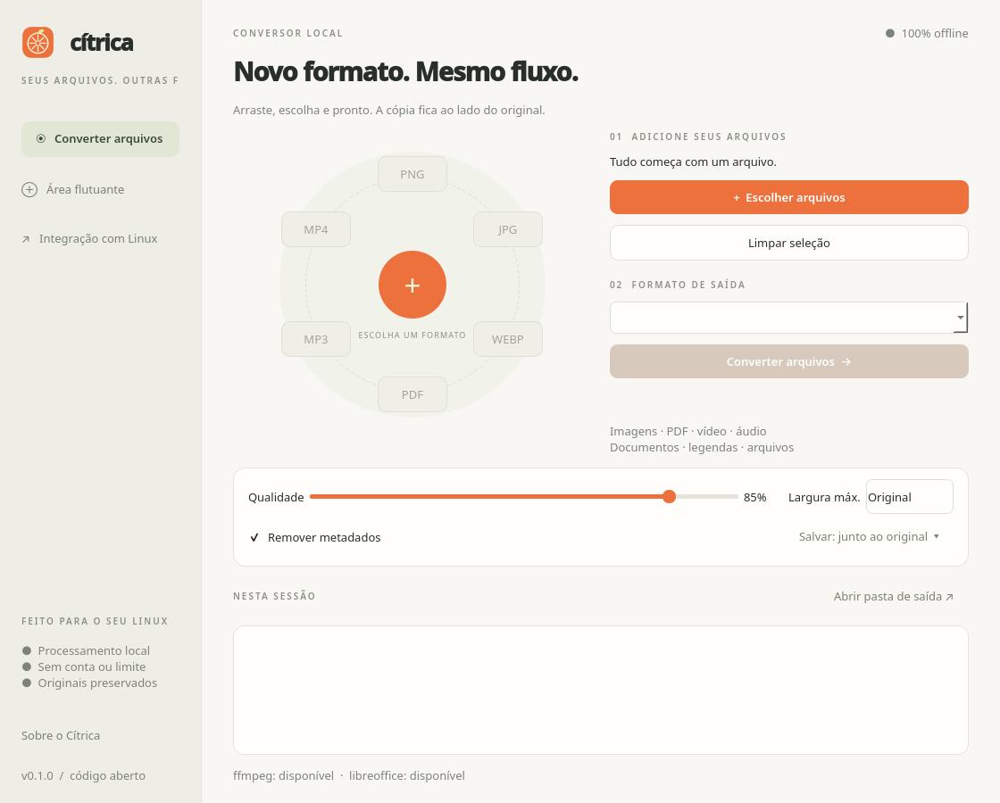

<p align="center"></p>
<h1 align="center">Cítrica</h1>
<p align="center">Novo formato. Mesmo fluxo.<br>Um conversor de arquivos local, gratuito e de código aberto para Linux.</p>
<p align="center"><a href="https://github.com/GenissonEmilio/citrica/releases">Baixar para Linux</a> · <a href="docs/ANALISE.md">Ideia e análise</a> · <a href="docs/ROADMAP.md">Próximos passos</a></p>



Arraste arquivos para o círculo, solte em um formato e receba uma cópia na pasta do original. Use a janela principal, a área flutuante, o menu de contexto do gerenciador de arquivos ou o terminal. Não há upload, conta, telemetria ou limite de conversões. Os arquivos originais são preservados; nomes repetidos recebem um sufixo.

Implementação independente inspirada na interação do [Tangerine](https://www.tangerineformac.com/), com código e identidade próprios. Não usa código nem recursos visuais do produto comercial e não é afiliada à Leap Studio.

## Instalação

Baixe os pacotes na [release](https://github.com/GenissonEmilio/citrica/releases). A versão **0.1.0 é uma prévia funcional** para Linux **x86_64**, compilada no Ubuntu 24.04; requer glibc 2.39 ou superior. ARM e distribuições mais antigas ainda não foram validados. O pacote inclui Python, Qt e os motores de imagem/PDF; FFmpeg e LibreOffice são dependências opcionais do sistema.

**Fedora 40+ / derivados RPM:**

```bash
sudo dnf install ./citrica-0.1.0-1.x86_64.rpm
```

**Ubuntu 24.04+ / derivados Debian compatíveis:**

```bash
sudo apt install ./citrica_0.1.0_amd64.deb
```

**Portátil:** extraia `citrica-0.1.0-linux-x86_64.tar.gz` e execute `./citrica/citrica`. Não exige instalação de Python. Para registrar o aplicativo no seu usuário, execute `./citrica/install.sh`. Mantenha `_internal` junto do executável. O instalador cria `~/.local/bin/citrica`; essa pasta deve estar no `PATH` para usar o comando pelo nome.

Confira o download com `sha256sum -c SHA256SUMS` na pasta dos arquivos baixados. O verificador pode informar arquivos ausentes se você não tiver baixado todos os pacotes.

Dependências para todos os recursos:

```bash
# Ubuntu
sudo apt install ffmpeg libreoffice
# Fedora: use um pacote FFmpeg com os codecs libx264, libmp3lame, libvpx-vp9 e libopus.
sudo dnf install libreoffice
```

O FFmpeg do repositório da distribuição pode ter codecs limitados. Se um encoder estiver ausente, a operação informa o erro e preserva o arquivo de origem. `citrica --doctor` informa as dependências encontradas; não instala nada.

## Como usar

1. Abra Cítrica e arraste um ou mais arquivos para o círculo; ou use **Escolher arquivos**.
2. Solte sobre um formato, clique nele ou escolha na lista e use **Converter arquivos**.
3. Ajuste qualidade, largura máxima e destino quando necessário. Os formatos oferecidos são a interseção das saídas disponíveis para a seleção.
4. Abra a pasta de saída ou dê dois cliques em um resultado. Falhas aparecem na lista com o motivo completo na dica do item.

**Área flutuante:** clique na opção da barra lateral ou execute `citrica --dock`. A janela permanece acima das demais onde o compositor permitir. Arraste sobre o círculo para revelar formatos e solte no desejado. Também é possível soltar no centro e clicar no formato depois.

**Integração:** `citrica --install-integrations` registra o aplicativo e instala menus para Dolphin e Nemo, um script do Nautilus e uma extensão do Nautilus Python no usuário atual. Reinicie o gerenciador. A extensão exige `python3-nautilus` no Ubuntu ou `nautilus-python` no Fedora; sem ela, use o submenu **Scripts → Converter com Cítrica**. Instale as integrações após colocar o aplicativo em sua localização definitiva. Os caminhos registrados apontam para esse executável.

No **Wayland**, um aplicativo comum não consegue interceptar Shift durante o arraste global de outro aplicativo. Esta versão usa a área flutuante e os menus de contexto; não promete capturar o gesto global do macOS. O posicionamento e a prioridade de janelas dependem do compositor. No GNOME, o ícone de bandeja também depende de suporte a AppIndicator. A janela principal continua disponível sem bandeja.

Atalhos: `Ctrl+O` para selecionar, `Ctrl+Enter` para converter, `Esc` para cancelar. Os botões do menu radial aceitam navegação por Tab e ativação por teclado. Não há execução automática ao iniciar a sessão.

## Formatos da versão 0.1.0

| Entrada | Saída | Motor |
| --- | --- | --- |
| JPG, PNG, WebP, TIFF, BMP, GIF, AVIF, HEIC/HEIF | PNG, JPG, WebP, AVIF, HEIC, TIFF, BMP, GIF, PDF | Pillow + pillow-heif |
| PDF | PNG/JPG, uma imagem por página; TXT; PDF regravado | PyMuPDF + pypdf |
| MP4, MOV, MKV, AVI, WebM, WMV, M4V, MPEG | MP4, WebM, MKV, MOV, GIF, MP3, WAV | FFmpeg |
| MP3, WAV, FLAC, OGG, Opus, M4A, AAC, AIFF, WMA | MP3, WAV, FLAC, OGG, Opus, M4A, AIFF | FFmpeg |
| DOC/DOCX, ODT, RTF, TXT | PDF, DOCX, ODT, TXT | LibreOffice; TXT→PDF tem motor interno |
| XLS/XLSX, ODS, CSV, TSV | PDF, XLSX, ODS, CSV | LibreOffice |
| PPT/PPTX, ODP | PDF, PPTX, ODP | LibreOffice |
| SRT, VTT | SRT, VTT, TXT | Interno |
| ZIP, TAR, TAR.GZ, TGZ | ZIP, TAR, TAR.GZ | Biblioteca padrão Python |

Ferramentas incluídas: redução de qualidade de imagens/vídeo, redimensionamento, remoção de metadados em imagens/PDF/mídia e união de PDFs na ordem da seleção. Para comprimir ou limpar uma imagem/PDF, selecione o mesmo formato de saída: será criada uma nova cópia. Reduzir qualidade não garante um tamanho menor. PDFs são regravados com compressão dos streams; não há redução de resolução de imagens internas ou meta exata de tamanho.

Limitações: imagens animadas e TIFFs com várias páginas são recusados para evitar perda silenciosa de quadros. SVG, RAR, Pages, OCR, edição de fotos, corte de vídeo e extração PDF→Office não estão nesta versão. PDF→TXT extrai texto existente; scans sem camada textual não passam por OCR. SRT/VTT preservam texto e tempos básicos; estilos, posicionamento e identificadores específicos de VTT não são preservados. Metadados de documentos Office não são removidos. Arquivos compactados são reempacotados, não extraídos; links, nomes inseguros e entradas duplicadas são recusados. Limite de 10.000 entradas / 2 GiB descompactados. A compatibilidade Office depende do filtro do LibreOffice e da formatação original.

## Terminal

```bash
citrica foto.heic --to jpg
citrica *.png --to webp --quality 80 --max-width 1920
citrica documento.pdf --to png --output ./paginas
citrica a.pdf b.pdf --merge-pdf --output ./resultado
citrica video.mov --to mp4
citrica legenda.srt --to vtt
citrica pacote.zip --to tar.gz
citrica foto.png --formats
citrica --doctor
```

O retorno é 0 para sucesso, 1 se houver falha e 130 para interrupção pelo teclado. Operações usam arquivos temporários na pasta de destino e publicação atômica sem sobrescrita. Em lotes, os resultados já concluídos são mantidos se houver erro ou cancelamento.

## Desenvolvimento

Python 3.11 ou superior:

```bash
python3 -m venv .venv
. .venv/bin/activate
pip install -e '.[dev]'
citrica
QT_QPA_PLATFORM=offscreen python -m pytest -q
ruff check citrica tests packaging
python packaging/build.py
```

O CI testa conversões reais, preservação dos originais, colisões de nomes, metadados, PDF com várias páginas, documentos Office, mídia, cancelamento, validação de arquivos compactados e arrastar/soltar na interface Qt. Tags `v*` geram pacotes `.deb`, `.rpm`, `.tar.gz`, prévia e checksums; a release só é publicada após os testes e o teste de abertura do binário empacotado.

## Licença

[AGPL-3.0-or-later](LICENSE). Consulte [THIRD_PARTY.md](THIRD_PARTY.md) para as dependências e licenças. O Cítrica não inclui FFmpeg nem LibreOffice nos pacotes; usa as instalações do sistema. Contribuições são bem-vindas por issues e pull requests.
