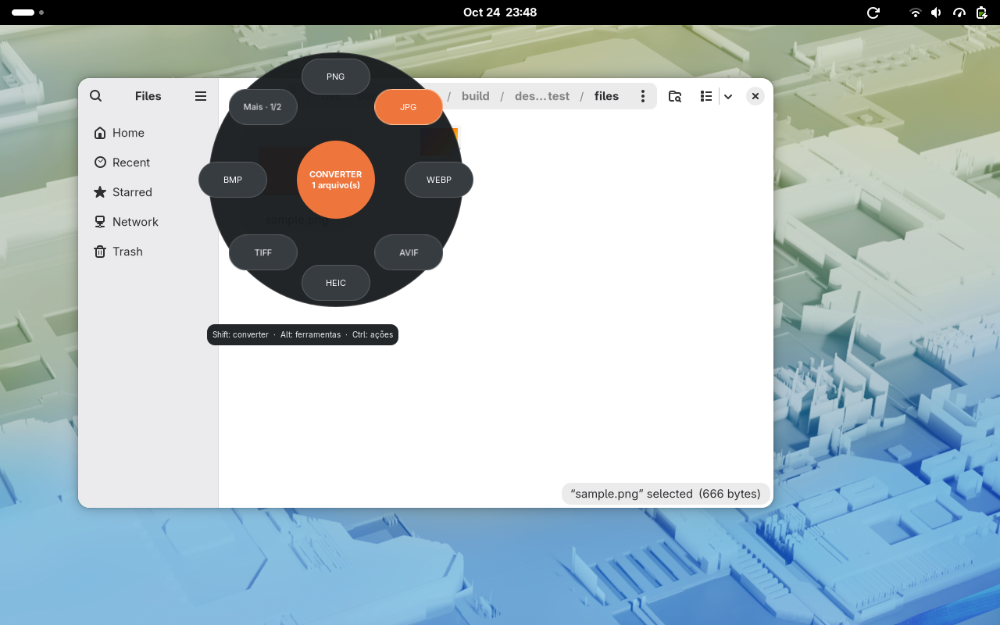
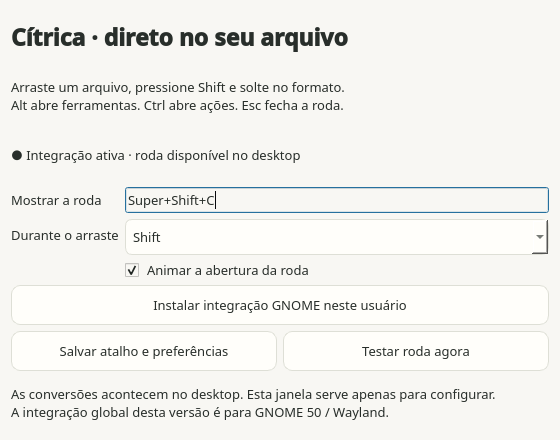

<h1 align="center">Cítrica</h1>

Arraste. Pressione Shift. Solte no formato. Conversão local no desktop Linux e Windows.

<a href="https://github.com/GenissonEmilio/citrica/releases/tag/v0.6.0">Baixar versão 0.6.0</a> · <a href="docs/UBUNTU.md">Instalar no Ubuntu</a> · <a href="docs/VALIDACAO-0.6.0.md">Validação e limites</a> · <a href="docs/ANALISE.md">Referência e decisões</a>

O Cítrica 0.6 oferece a roda nativa do GNOME Shell no Linux e uma integração Qt/Win32 no Windows. A roda aparece perto do ponteiro durante o arraste de arquivos. A janela do aplicativo serve para configurar o atalho; ferramentas que precisam de parâmetros abrem um diálogo específico.

**Versão 0.6.0:** motores offline incluídos no Windows, correções de travamento da roda e atualização do instalador com o aplicativo aberto. O DEB passou em instalação, primeira abertura como usuário comum, conversão e remoção no Ubuntu **24.04, 26.04 e 26.10**. A roda foi testada separadamente nos GNOME 46/50/51. [Instalar no Ubuntu](docs/UBUNTU.md). **O Windows continua sem assinatura pública**. A candidatura à SignPath Foundation foi recusada em 29/10/2026 por insuficiência de sinais públicos de adoção e visibilidade. A distribuição pela Microsoft Store está em preparação, com MSIX aceito em rascunho e certificação pendente.

**Na 0.5.0:** correções da roda no Explorer, DOCX→PDF/TXT sem Office, PDF→DOCX em ambas as plataformas e miniatura do arraste acima da roda no GNOME. A roda reabre vazia após converter ou cancelar e mantém as animações de abertura, seleção e fechamento. [Veja a gravação nativa](docs/wheel-native.mp4) e a [análise visual](docs/ANALISE.md).

Implementação independente inspirada no fluxo do [Tangerine](https://www.tangerineformac.com/), com código e identidade próprios. Não é afiliada ao produto comercial e não oferece todas as suas combinações de formatos.

## Windows x64

A 0.6.0 inclui FFmpeg/ffprobe, LibreOffice e OCR. O CI completo passou por 304 conversões de 50 extensões, ferramentas e arrastes no Explorer. Os ícones da roda usam vetores e a atualização encerra versões antigas por um helper próprio. Os pacotes `unsigned-test` são os mesmos arquivos validados na VM Windows 11; estão disponíveis para teste público, com assinatura pública ainda pendente. [Validação e limites](docs/VALIDACAO-0.6.0.md).

Baixe o [instalador .exe](https://github.com/GenissonEmilio/citrica/releases/download/v0.6.0/citrica-0.6.0-windows-x86_64-setup-unsigned-test.exe) ou o [ZIP portátil](https://github.com/GenissonEmilio/citrica/releases/download/v0.6.0/citrica-0.6.0-windows-x86_64-portable-unsigned-test.zip). O instalador usa a conta atual e cria a entrada **Enviar para → Cítrica**. No portátil, extraia tudo e abra `Citrica.exe` mantendo `_internal` ao lado.

Arraste no Explorer, pressione **Shift** e solte no formato. **Alt** abre ferramentas; **Ctrl**, ações. **Ctrl+Alt+C** abre/fecha a roda. O aplicativo permanece na bandeja ao fechar as configurações. O atalho e a inicialização automática são configuráveis.

Python, Qt, motores de imagem/PDF, QR e detecção de rostos estão incluídos. **PDF→DOCX, DOCX→PDF/TXT, áudio/vídeo e OCR funcionam com os motores incluídos, sem instalar Office, FFmpeg ou Tesseract à parte.** O instalador ainda não tem assinatura digital. Os resultados e limites dos testes do Explorer estão na documentação de validação.

Veja o [guia de instalação e roteiro de teste no Windows](docs/WINDOWS.md).

## Fedora / GNOME 50 / Wayland

Demonstração no Fedora: arraste o arquivo, escolha o formato na roda e receba a cópia convertida. [Baixar o vídeo em MP4](docs/citrica-linux.mp4).

https://github.com/user-attachments/assets/812f2703-e781-4b44-a544-3829eae95688

Baixe o RPM da [release v0.6.0](https://github.com/GenissonEmilio/citrica/releases/tag/v0.6.0):

~~~bash
sudo dnf install ./citrica-0.6.0-1.x86_64.rpm
citrica --install-gnome
~~~

Na primeira instalação, **saia e entre novamente na sessão do GNOME** para ele descobrir a extensão. Atualizações do código da extensão também exigem uma nova sessão; fechar o aplicativo não recarrega o Shell. As configurações informam se a sessão ainda está usando uma revisão anterior.

1. No gerenciador de arquivos, comece a arrastar uma imagem.
2. Toque **Shift** e solte a tecla. A roda aparece com os formatos compatíveis.
3. Continue arrastando e solte o arquivo no setor **JPG**, por exemplo.
4. Uma cópia aparece junto ao original; uma notificação confirma a conclusão.

**Alt** durante o arraste mostra ferramentas. **Ctrl** mostra ações. **Esc** cancela. O atalho **Super+Shift+C** abre/fecha a roda sem iniciar um arraste. Sem seleção, arraste um arquivo para ela ou clique no centro para escolher arquivos. Para várias páginas de opções, use **Mais** e clique na ferramenta desejada. Setas e Enter também selecionam e aplicam opções.

Abra **Cítrica** no menu de aplicativos ou execute `citrica --settings` para trocar o atalho, escolher Shift/Super durante o arraste e ligar/desligar a animação. O formulário verifica teclas inválidas e conflitos com atalhos registrados no GNOME.

A versão **0.6.0** oferece roda global em **GNOME Shell 46, 50 e 51 / Wayland**, incluindo Ubuntu 24.04, 26.04 e 26.10. A CLI funciona em outros ambientes; KDE, Cinnamon e X11 continuam sem roda global. Os pacotes oficiais são x86_64, com glibc >= 2.39.

## Ubuntu 24.04 / 26.04 / 26.10

Baixe diretamente o [instalador DEB 0.6.0](https://github.com/GenissonEmilio/citrica/releases/download/v0.6.0/citrica_0.6.0_amd64.deb). Não é preciso entrar no GitHub nem extrair um ZIP.

Abra o DEB com o instalador de aplicativos do Ubuntu. Se a loja não abrir pacotes locais, abra um terminal na pasta do arquivo e execute:

~~~bash
sudo apt update
sudo apt install ./citrica_0.6.0_amd64.deb
~~~

O `apt` resolve as dependências automaticamente. Abra **Cítrica** no menu para preparar a integração e o atalho. Quando as configurações pedirem, salve seu trabalho, **saia e entre novamente no GNOME** para carregar a extensão. Depois arraste um arquivo no **Arquivos**, toque **Shift** e solte no formato desejado. [Compatibilidade, dependências e resultados dos testes](docs/UBUNTU.md).

## Pacotes 0.6.0 e dependências

~~~bash
# Ubuntu 24.04 ou mais recente
sudo apt install ./citrica_0.6.0_amd64.deb
# Portátil, sem precisar instalar Python
 tar -xzf citrica-0.6.0-linux-x86_64.tar.gz
 ./citrica/install.sh
~~~

O instalador portátil registra o aplicativo em `~/.local/bin/citrica`, configura a extensão e instala menus de contexto no usuário atual. O RPM/DEB registra o aplicativo no sistema. Na 0.6.0, a primeira abertura pelo menu prepara a integração; `citrica --install-gnome` também permite configurá-la manualmente. Para menus de contexto opcionais, execute `citrica --install-integrations`. O script do Nautilus funciona sem plugin adicional; a entrada direta exige `nautilus-python`. A roda exige uma das versões de GNOME/Wayland indicadas acima.

Os pacotes Linux incluem Python, Qt, Pillow, motores PDF, leitor QR, modelo de rostos OpenCV e Tesseract com modelo de texto inglês. **FFmpeg e LibreOffice são programas opcionais do sistema**:

~~~bash
# Fedora: LibreOffice; use um FFmpeg com os codecs desejados habilitados
sudo dnf install libreoffice
# Debian/Ubuntu
sudo apt install ffmpeg libreoffice
citrica --doctor
~~~

Mídia exige FFmpeg/ffprobe; codecs variam entre instalações. Falhas de codec são informadas sem alterar a origem. LocalSend é opcional para compartilhamento, aparece nas ações somente quando o comando `localsend` está disponível e abre o aplicativo para concluir o envio. AirDrop não está implementado.

Confira `SHA256SUMS` na pasta dos downloads. Mantenha `_internal` junto ao executável portátil. A extensão e seu backend precisam continuar no caminho registrado; reinstale a integração se mover o aplicativo.

## Ferramentas

As opções dependem do tipo de arquivo e das dependências disponíveis. As ferramentas geram cópias; **Mover** é a ação explícita que muda o local do original.

| Grupo | Ferramentas implementadas |
| --- | --- |
| Imagem | Comprimir, tamanho alvo, recortar visualmente, brilho/contraste/saturação/nitidez, anotar com texto/número/seta/retângulo/elipse, fundo sólido/gradiente/imagem, margens/proporção/cantos, ocultar área manualmente, ocultar rostos, ocultar texto, ler QR, colagem, imagens em PDF |
| Áudio/vídeo | Comprimir, tamanho alvo, cortar tempo, velocidade, dividir, unir seleções compatíveis; recortar vídeo e capturar quadro; normalizar áudio, censurar trecho com tom e converter mono/estéreo |
| PDF | Comprimir, tamanho alvo, unir, dividir em páginas, reorganizar páginas |
| Metadados | Inspecionar, limpar e editar autor/título em imagens, PDF, áudio e vídeo |
| Ações | Copiar, mover, copiar caminho, abrir terminal, prateleira flutuante, compartilhar por LocalSend quando instalado |

Há 26 entradas de ferramentas e 6 ações no catálogo, com equivalentes adaptados ao Linux. Isso **não representa paridade completa** com cada função/algoritmo do Tangerine. Veja o [escopo testado](docs/VALIDACAO.md).

O tamanho alvo publica somente resultados que respeitam o limite solicitado; se não conseguir, informa falha. Imagens saem em WebP e podem perder resolução; áudio sai em MP3 e vídeo em MP4. PDF preserva o texto e comprime imagens internas; pode não atingir limites muito baixos. Detecção de rosto/texto pode deixar áreas sem identificar: revise a cópia e use ocultação manual quando necessário. O modelo de texto incluído é inglês; este recurso oculta regiões de texto e não exporta documentos escaneados por OCR.

## Conversões

| Entrada | Saída | Motor |
| --- | --- | --- |
| JPG, PNG, WebP, TIFF, BMP, GIF, AVIF, HEIC/HEIF | PNG, JPG, WebP, AVIF, HEIC, TIFF, BMP, GIF, PDF | Pillow + pillow-heif |
| PDF | DOCX editável, PNG/JPG por página, TXT, PDF | pdf2docx + PyMuPDF + pypdf |
| MP4, MOV, MKV, AVI, WebM, WMV, M4V, MPEG | MP4, WebM, MKV, MOV, GIF, MP3, WAV | FFmpeg |
| MP3, WAV, FLAC, OGG, Opus, M4A, MKA, AAC, AIFF, WMA | MP3, WAV, FLAC, OGG, Opus, M4A, AIFF | FFmpeg |
| DOCX | PDF, TXT | Motor incluído; LibreOffice opcional para maior fidelidade e ODT |
| DOC, ODT, RTF, TXT | PDF, DOCX, ODT, TXT | LibreOffice; TXT→PDF/DOCX interno |
| XLS/XLSX, ODS, CSV, TSV | PDF, XLSX, ODS, CSV | LibreOffice |
| PPT/PPTX, ODP | PDF, PPTX, ODP | LibreOffice |
| SRT, VTT | SRT, VTT, TXT | Interno |
| ZIP, TAR, TAR.GZ, TGZ | ZIP, TAR, TAR.GZ | Python |

Saídas são publicadas atomicamente, junto ao original por padrão; nomes repetidos recebem sufixos. Imagens animadas/multipágina são recusadas para evitar perda de quadros. SVG, RAR, Pages, EPUB e PDF→XLSX/PPTX não estão implementados. PDF→DOCX preserva texto/tabelas/imagens conforme o layout; PDFs escaneados mantêm as páginas como imagens, sem OCR automático. O motor básico de DOCX→PDF preserva conteúdo e pode alterar layouts avançados; LibreOffice é recomendado nesses casos e continua necessário para DOC/ODT/RTF, planilhas e apresentações; a limpeza de metadados não cobre documentos Office. Legendas preservam texto e tempos básicos, sem estilos específicos. Arquivos compactados são reempacotados, sem extração pública; links, nomes inseguros e entradas duplicadas são recusados (10.000 entradas / 2 GiB descompactados).

## Terminal e desenvolvimento

~~~bash
citrica foto.heic --to jpg
citrica *.png --to webp --quality 80 --max-width 1920
citrica documento.pdf --to png --output ./paginas
citrica a.pdf b.pdf --merge-pdf --output ./resultado
citrica video.mov --to mp4
citrica foto.png --formats
citrica --wheel foto.png
citrica --tool crop foto.png
~~~

Python 3.12 ou superior:

~~~bash
python3 -m venv .venv
. .venv/bin/activate
pip install -e '.[dev]'
QT_QPA_PLATFORM=offscreen python -m pytest -q
ruff check citrica tests packaging
# Teste real do compositor, com GNOME 46, 50 ou 51 instalado:
python tests/desktop/run_session.py
# Pacotes com PyInstaller, RPM/DEB quando as ferramentas estão instaladas:
python packaging/build.py
~~~

O teste do desktop cria outro compositor GNOME/Wayland com barramento e configurações isolados. A extensão de teste nunca é instalada no desktop do usuário nem incluída nos pacotes. O CI verifica o motor, o executável empacotado e a instalação DEB nos três Ubuntu. Os percursos nativos da candidata foram executados separadamente em GNOME 46/51 nos containers Ubuntu e GNOME 50 no Fedora. [Resultados Ubuntu 0.6.0](docs/UBUNTU.md) e [histórico da estável 0.5.0](docs/VALIDACAO.md).

## Licença

[AGPL-3.0-or-later](LICENSE). Dependências e avisos em [THIRD_PARTY.md](THIRD_PARTY.md). Os arquivos não são enviados para serviços externos durante conversões; o compartilhamento só abre o aplicativo escolhido por uma ação explícita.
