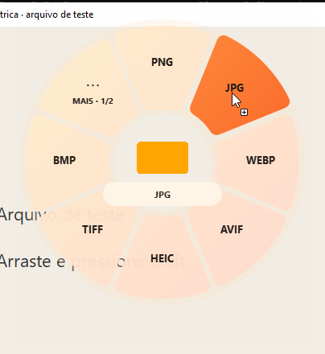
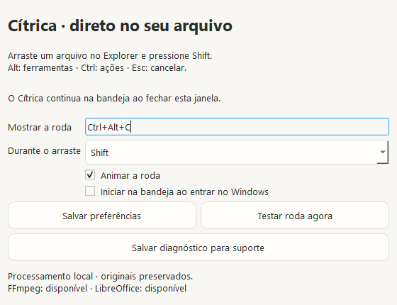

# Validação da versão 0.4.0

A 0.4.0 adiciona a integração Windows ao motor compartilhado. A validação automatizada e a validação manual no computador de um usuário são registradas separadamente. O teste externo no Explorer foi combinado com o usuário e permanece pendente até que seu amigo o execute.

## Motor e interface

No Fedora, a suíte concluiu **98 testes aprovados e um teste Win32 ignorado**, que é executado pelo CI Windows. Há quatro avisos de depreciação de construtores de eventos Qt nos testes.

A suíte cobre conversões reais de imagem/PDF/Office/mídia/legendas/arquivos, preservação dos originais, colisões concorrentes, cancelamento, caminhos inseguros recusados, recorte visual, orientação EXIF, rostos, texto e QR. As 26 entradas do catálogo de ferramentas têm testes com resultados verificáveis, conforme documentado na [validação 0.3.0](VALIDACAO-0.3.0.md). As dependências opcionais usadas pelo CI são instaladas antes dos testes.

## Windows

A roda é um QWidget transparente sem moldura, com geometria de setores anulares, miniatura local, animação, paginação e destaque sob o ponteiro. O Windows observa modificadores/botão e recebe os arquivos pela oferta OLE do Qt. O atalho usa RegisterHotKey; instâncias adicionais se comunicam por um named pipe limitado ao usuário atual.

Os testes da implementação Qt Windows conferem:

- Geometria dos setores e transparência do retângulo externo, incluindo o estilo global do aplicativo.
- Arraste com Shift solicitando efeito **CopyAction**, publicação JPG real e original intacto.
- Limpeza síncrona de caminhos, itens, miniatura, destaque e cache, antes de o motor/animação terminar.
- Erro de conversão, Escape, resposta atrasada e reabertura vazia.
- Ferramentas, ações, copiar caminho, paginação que mantém a seleção somente dentro da abertura atual e navegação por teclado.
- Preferências, validação de atalhos e recusa de conflito sem perder o atalho anterior.
- Ativação silenciosa até receber uma oferta de arquivo local; uma seleção de texto não revela a roda.
- O aplicativo permanece residente depois de Copiar e de o usuário substituir o conteúdo da área de transferência.
- APIs Win32: registro real, conflito real com um atalho mantido por outra thread e liberação ao encerrar. Esse teste é executado somente no Windows.

**99 testes passaram no CI Windows**, incluindo o teste Win32 de conflito de atalho. O CI usa **Windows Server 2022 x64**, Python 3.12 e as bibliotecas de requirements.lock. O executável PyInstaller é testado por subprocessos, sem usar os imports do código-fonte para fazer a conversão. O instalador Inno Setup e o portátil compartilham o mesmo payload, com inicializador gráfico e CLI separados.

O instalador recebe também um teste automático de instalação no usuário, versão da CLI instalada, abertura das configurações, criação de Enviar para, desinstalação e remoção da entrada de inicialização automática. Capturas das configurações usam o plugin nativo Windows, com Segoe UI.

`tests/windows/native_flow.py` tenta um percurso nativo com SendInput, uma origem Qt em outro processo e o executável gráfico empacotado. Verifica Shift global, OLE, JPG, original, atalho, reabertura vazia e Escape. Se o runner não oferecer desktop de entrada visível, isso é registrado como indisponível, não como teste aprovado. A origem Qt desse teste **não é o Explorer**.





**Validação manual no Explorer: pendente do teste externo.** O [guia Windows](WINDOWS.md) traz o roteiro, dependências, instalação e coleta de diagnóstico. A cobertura automatizada não representa todos os computadores, monitores, escalas, codecs ou documentos. O instalador não tem assinatura digital.

## Linux / Fedora

Ambiente local: Fedora 44, GNOME Shell 50.5, Mutter 50.6, Wayland x86_64, em 25/10/2026. A suíte nativa foi repetida com o motor atualizado:

- Arraste Qt e Nautilus com Shift, conversão JPG e preservação da origem.
- Alt/Ctrl, ferramentas, copiar caminho e copiar/colar no Nautilus.
- Terminal na pasta correta e arraste da prateleira.
- Configuração e invocação global de outro atalho, restauração do padrão e escolha do modificador.
- Conversão repetida, erro, Escape, respostas atrasadas e abertura vazia pelo atalho.
- Estados intermediários reais da animação e gravação pelo compositor.

O teste usa outro compositor GNOME real com barramento DBus e configurações isolados. Nenhum evento é enviado à sessão de trabalho do usuário e não é alterada a segurança do Shell. O harness não acompanha os pacotes.

```bash
python tests/desktop/run_session.py tests/desktop/run_all.py
# Repetir com um portátil Linux:
CITRICA_TEST_EXECUTABLE=/caminho/absoluto/citrica/citrica python tests/desktop/run_session.py tests/desktop/run_all.py
```

Nos pacotes Linux publicados da 0.4.0, a extensão usa a versão 3, revisão 1. O motor 0.4.0 mantém o mesmo protocolo da roda. KDE, Cinnamon, X11 e outras versões de GNOME não receberam validação de roda global.

### Correção de camadas posterior à release 0.4.0

Na branch `main`, a extensão passa à revisão 2: a roda fica abaixo da camada de feedback do compositor, mantendo a miniatura nativa do arquivo acima dos setores. A revisão 1 continua nos pacotes já publicados da 0.4.0.

O teste `run_stacking.py` compara os pixels da miniatura durante um arraste Wayland real antes e depois de abrir a roda com Ctrl, Alt e Shift. Ele reproduziu a miniatura coberta na revisão anterior e passou após a correção, incluindo conversão por drop e reabertura vazia. O percurso do Nautilus também verifica a ordem das camadas com sua miniatura nativa. Esses testes integram `run_all.py`.

Para ativar a nova revisão em uma sessão que já carregou a extensão, é necessário sair e entrar novamente no GNOME.

## Pacotes e evidências

Resultados estruturados, referências do CI e checksums estão em [validation.json](validation.json). Cada release disponibiliza SHA256SUMS; o pacote Windows inclui um guia de teste. Os relatórios automáticos do Windows distinguem o teste do motor empacotado e o teste nativo do desktop, sem declarar a validação manual como concluída.

## Release publicada

O [CI da tag v0.4.0](https://github.com/GenissonEmilio/citrica/actions/runs/40217795312) concluiu os builds Linux/Windows, os testes do executável congelado, o arraste nativo entre processos no Windows e a instalação/desinstalação. Os checksums do instalador Windows e das evidências foram conferidos após baixar os anexos. As imagens Windows acima são dessa execução da tag.

No Fedora, o portátil do CI candidato d3a6ee1 passou nos testes reais de motor e em todos os percursos GNOME. O executável da release é idêntico em bytes ao candidato testado. Todos os 762 arquivos de runtime também coincidem, exceto os metadados do arquivo base_library.zip: seus arquivos internos são idênticos. O TAR.GZ final foi conferido com SHA256SUMS. Assim, a validação no Fedora usa o mesmo código e runtime distribuídos na release.

O teste manual no Explorer do computador do usuário continua pendente. Nenhuma validação externa foi atribuída ao amigo antes de ele realizar o roteiro.
