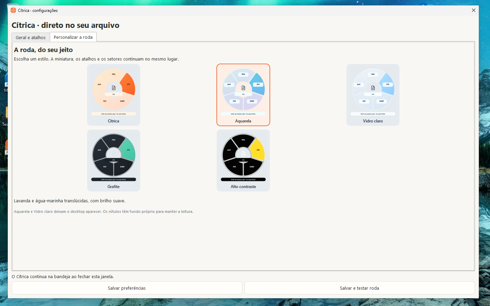
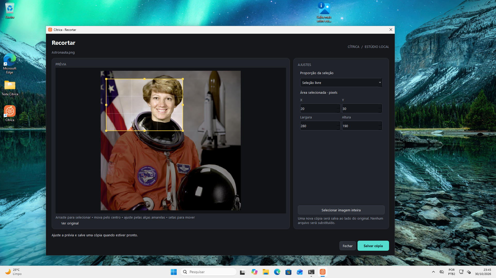
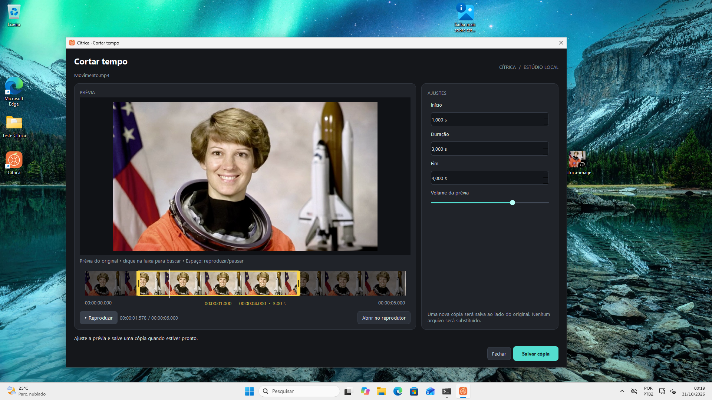
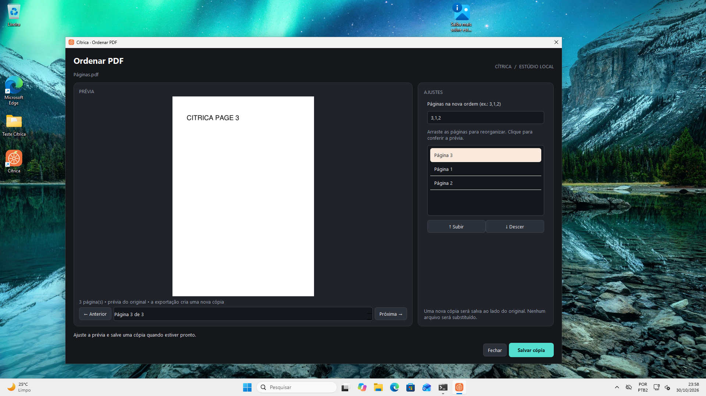

# Validação do Cítrica 0.7.0

Produto 0.7.0; pacote Microsoft Store 1.7.0.0; protocolo GNOME 3, revisão 4. Este documento acompanha os resultados da atualização. O histórico anterior permanece em [0.6.0](https://github.com/GenissonEmilio/citrica/blob/05462b6150b4484816668317c9a5937192aa459d/docs/VALIDACAO-0.6.0.md).

## Escopo

- Cinco estilos compartilhados entre Qt e GNOME, persistência das preferências e migração sem redefinir atalhos.
- Editores visuais de imagem/PDF e player/linha do tempo de áudio/vídeo, exportações reais e cancelamento.
- Detecção LocalSend Linux nativa/Flatpak/AppImage e encaminhamento dos arquivos.
- Cancelamento do arraste Windows: fora do anel, centro vazio, oferta OLE atrasada, soltura não notificada e novo gesto depois de Mais.
- Pacotes completos Linux/Windows e atualização MSIX com identidade preservada.

## Resultados em código-fonte

O teste GNOME 50/Wayland em compositor isolado trocou os cinco estilos durante um arraste real, preservou arquivo, opções e miniatura, converteu para JPG e reabriu a roda vazia. O recibo da revisão 4 registra 14 quadros intermediários de animação. Esse teste não reiniciou nem substituiu a extensão na sessão de trabalho do usuário.

No Fedora, a detecção real encontrou LocalSend 1.18.2 instalado como Flatpak de sistema (`org.localsend.localsend_app`), sem executável no PATH. A paleta do protocolo passou a incluir Compartilhar. Os testes verificam `--file-forwarding` com nomes Unicode e espaços; não iniciam transferências reais.

Os testes dos editores exportam recortes e ajustes de imagem, fundo com proporção, PDF reordenado, trim de vídeo e bleep de áudio. Também exercitam alças/arraste, sincronização dos campos, miniaturas, forma de onda, reprodução/pausa/seek no QtMultimedia e cancelamento seguro de subprocessos e workers.

O encerramento foi testado em subprocessos independentes: fechar/exportar PDF, sair com worker ativo, capturar com prévia ativa e abrir/fechar cinco PDFs no residente. Threads são canceladas e aguardadas; a árvore de widgets é destruída enquanto o QApplication está vivo. A prévia PDF também foi verificada em três tamanhos de janela, preservando topo, rodapé e proporção.

A suíte completa foi executada três vezes em processos independentes no Fedora: 353 testes passaram e 21 foram ignorados em cada execução, com código de saída 0. O [recibo](evidence/0.7.0/unit-lifecycle.json) distingue esses testes dos pacotes. A limpeza de janelas criadas diretamente pelos testes também foi corrigida; nenhuma assertion foi removida e nenhum erro fatal foi suprimido.

A [verificação final de código-fonte](evidence/0.7.0/source-tests-final.json) passou 357 testes e ignorou 21 em cada plataforma, Linux e Windows, com saída 0. O teste de escala Windows usa o renderizador nativo e fontes Segoe UI: o plugin genérico offscreen não disponibiliza fontes nesse sistema e não representa as métricas do aplicativo. A [prova separada na VM](evidence/0.7.0/windows-settings-dpi-source.json) confirma os cinco estilos e os dois botões de salvar dentro da área útil em 100% e 150%; ela usa código-fonte e não substitui o teste do pacote final.

A [regressão de evento tardio da prévia](evidence/0.7.0/late-preview-callback.json) reproduziu uma corrida estreita: a thread já reportava finalização, a janela recebia DeferredDelete e uma lambda ainda acessava o diálogo destruído. Os sinais de prévia agora usam slots com contexto do EditorDialog; Qt descarta a entrega se o receptor foi destruído. O teste falhou antes e passou depois da correção, incluindo sinais ready, failed e finished tardios, cancelamento e liberação da thread. Não houve perda de arquivo na reprodução.

A [última checagem do PR no Linux](evidence/0.7.0/linux-ci-diagnostic.json) teve uma tentativa sem progresso visível por mais de nove minutos e foi cancelada, sem atribuir aprovação a essa execução. Uma única reprodução local isolada passou 357 testes e ignorou 21 em 49,41 s, com saída 0. O workflow passou a manter saída sem buffer, rastros periódicos e limite de dez minutos nessa etapa, preservando a mesma coleta e todas as assertions. Os resultados posteriores permanecem nos checks do PR; essa mudança é de diagnóstico do CI e não altera os binários congelados.

## Pacotes e publicação

O [build Linux](evidence/0.7.0/linux-packages-ci.json) passou 304 conversões sobre 50 extensões e 38 operações estáticas de imagem/PDF (32 positivas e seis rejeições esperadas), com originais preservados. O DEB passou instalação, abertura, conversão e remoção em Ubuntu 24.04, 26.04 e 26.10 limpos.

O [TAR final do commit 027e785 no Fedora/GNOME 50](evidence/0.7.0/linux-frozen-gnome.json) passou pelos editores e controles reais, pelas cinco aparências durante o arraste, persistência das preferências, atalho global e presença de Compartilhar. O player avançou 0,557 s durante a reprodução, manteve a posição em pausa, navegou para 1,812 s e exportou um corte de 1,25 s. Todos os processos de editor encerraram com código 0; página PDF inteira e botões de configurações ficaram visíveis em 1280×800. A roda registrou 27 quadros intermediários de animação. Três fechamentos do vídeo imediatamente após mapear a janela também encerraram com saída 0, sem callbacks em QObject destruído, usando WM_DELETE dirigido ao PID e à janela. O áudio sintético foi silenciado no teste e não houve envio pelo LocalSend.

A [instalação local](evidence/0.7.0/local-install.json) foi atualizada para esse mesmo binário, com backup e preferências preservadas. A extensão revisão 4 está no disco; a sessão em execução ainda mantém uma revisão anterior até o próximo login, sem encerrar o trabalho do usuário. A conferência posterior confirmou o mesmo hash do aplicativo e a extensão ativa, mas ainda na revisão 3 em memória.

O [pacote Windows do commit 027e785](evidence/0.7.0/windows-packages-ci.json) passou no CI por 304 conversões sobre 50 extensões, 23 operações de mídia e 38 operações estáticas (32 positivas e seis rejeições esperadas), com originais preservados. O instalador passou instalação por usuário em caminho Unicode, abertura, atualização com residente ativo e remoção. Os testes reais do Explorer passaram em 100% e 150%, com motores offline, DOCX↔PDF editável e conversões repetidas na mesma pasta. Os relatórios mantêm a origem dos motores e a condição de pacote sem assinatura pública.

Na [VM Windows 11](evidence/0.7.0/windows-frozen-vm.json), o mesmo binário final passou por recorte de imagem de 280×190 com comparação de todos os pixels, ajuste de brilho, reprodução/pausa e corte de vídeo de 2,5 s, substituição de trecho de áudio por tom de 1000 Hz e reordenação de PDF para 3,1,2. Três fechamentos durante a preparação real da prévia, dois de vídeo e um de áudio, encerraram com código 0 e stderr vazio. Os editores também encerraram normalmente após exportar. Nessa primeira execução portátil, o clique de navegação não teve a posição resultante assertada; o recibo distingue essa ação do oráculo de reprodução e duração. O driver exigia título/imagem exatos e uma única janela, seguido de encerramento normal do processo lançado; a versão pública agora também exige explicitamente que o PID da janela seja o do processo criado.

Os 12 percursos reais do Explorer passaram, incluindo soltura fora da roda em Ctrl/Alt/Shift sobre uma janela externa identificada por HWND/PID/classe, centro sem opção, Mais, Esc, reabertura vazia pelo atalho, ferramentas Alt e DOCX↔PDF com texto editável. O residente respondeu após o editor e encerrou normalmente com código 0, sem encerramento forçado; os originais foram preservados. Uma falha de impressão Unicode no runner privado ocorreu depois de gravar o resultado aprovado e não foi confundida com o código de saída do aplicativo.

O [MSIX QA 1.7.0.0 instalado](evidence/0.7.0/windows-msix-vm.json) confirmou a identidade real do processo antes de salvar preferências. Os cinco estilos foram salvos e exibidos na roda, Esc limpou a seleção e as configurações reabriram pela operação oficial do aplicativo. A escolha persistiu após encerramento normal e novo processo. A escala Qt efetiva de 1,0 e 1,5 foi medida no tamanho físico dos cards; o DPI global do Windows permaneceu 96. Os botões couberam na área útil nas duas escalas e o fluxo Salvar e testar → configurações ocultas → Sair terminou com código 0. O Inno e sua inicialização foram preservados; não houve mudança de certificados, Developer Mode ou políticas de segurança. Esse teste usou a identidade QA separada, não o pacote entregue pela Store.

O [teste final dentro do MSIX instalado](evidence/0.7.0/windows-msix-final-smoke.json), após o WACK, confirmou PID da janela igual ao processo lançado, PFN QA real e execução medium. O player avançou para 1,636 s, pausou, navegou para exatamente 2,5 s e exportou 2,0 s; o editor fechou com código 0. DOCX→PDF e PDF→DOCX editável passaram pelo executável registrado do pacote, com texto verificado independentemente e originais intactos. O ffprobe usado como oráculo é byte a byte igual ao do portátil validado: uma tentativa anterior de executar esse helper diretamente de WindowsApps, fora do contexto do pacote, recebeu WinError5 depois que o aplicativo já exportara. O histórico de oráculos permanece separado do resultado do produto.

O [WACK 1.7.0.0](evidence/0.7.0/windows-wack-1.7.0.0.json) completou a execução inteira em 26 min 15 s, com saída 0: **22 PASS, um FAIL opcional e um WARNING obrigatório; nenhum FAIL obrigatório**. O resultado global foi WARNING. A falha opcional de Executáveis bloqueados contém referências estáticas a criação de processos e nomes em bibliotecas/motores incluídos; ela não comprova que cada string apontada foi executada. O aviso de DPI foi preservado: o manifest do executável não declara dpiAware/dpiAwareness e o kit não processou o binário nessa etapa. Os testes Qt em escala efetiva 1,0/1,5 são evidência separada e não validam mudança de DPI entre monitores. O recibo mantém os achados, as referências oficiais e a distinção entre requisitos e verificações opcionais.

O [pacote oficial 1.7.0.0 foi enviado à Microsoft](evidence/0.7.0/store-update-status.json) em 31/10/2026. O Partner Center confirmou Submission 2 **Na certificação**, em pré-processamento, com publicação automática após aprovação. As cinco capturas atuais e suas legendas foram salvas. A versão pública anterior continua disponível enquanto a atualização é analisada. O CI, WACK e as verificações funcionais não são tratados como certificação da Microsoft.

A [VM foi restaurada e salva](evidence/0.7.0/windows-vm-cleanup.json) após os testes: instalação anterior, preferências e seis arquivos externos permaneceram intactos; pacote QA e fixture do desktop foram removidos com guardas de identidade/hash. Os controladores de QA foram encerrados, a mídia privada foi destacada e o libvirt concluiu managed save sem destruir a VM.

## Capturas do pacote final no Windows

As imagens abaixo foram capturadas no aplicativo real da VM. Imagem, PDF, vídeo e roda têm 1920×1080 pixels; configurações usam uma região nativa de 1440×900, sem redimensionar o PNG.

## Limites

Os estilos translúcidos usam alpha real; não aplicam blur ao desktop. Há prévia do primeiro arquivo em operações múltiplas. As ferramentas são editores focados: não há montagem multipista, transições ou editor completo de Office. O player depende dos codecs do Qt; miniaturas e quadros por FFmpeg servem de alternativa quando suportados. A exportação usa os motores de conversão próprios e pode exigir FFmpeg/LibreOffice no Linux.

LocalSend em instalação Flatpak customizada por nome não é descoberto automaticamente. AppImages precisam ter permissão de execução e estar em pastas usuais ou em um launcher seguro. A ação abre o aplicativo com os arquivos; o usuário conclui o envio no LocalSend.

GitHub EXE/ZIP continuam sem assinatura pública. O MSIX oficial é preparado separadamente para certificação e assinatura da Microsoft Store; um pacote QA local não demonstra instalação pela Store.
